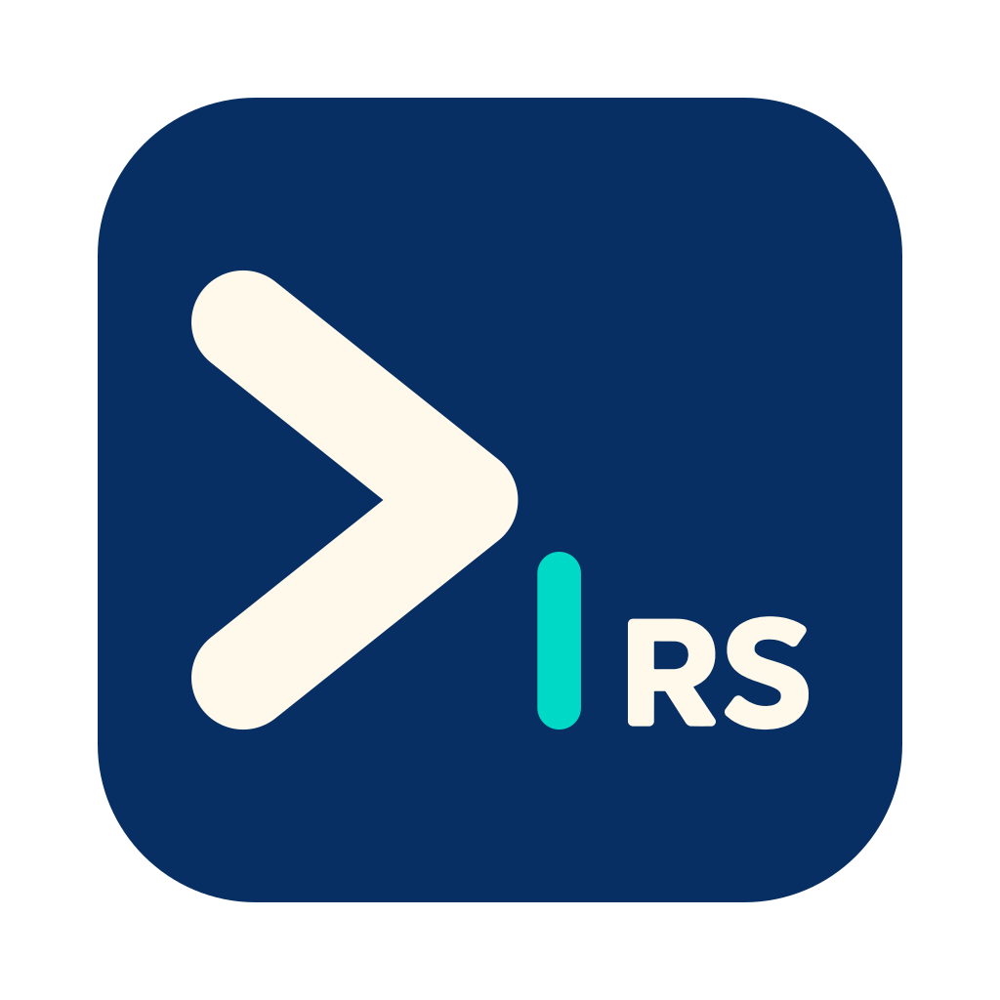
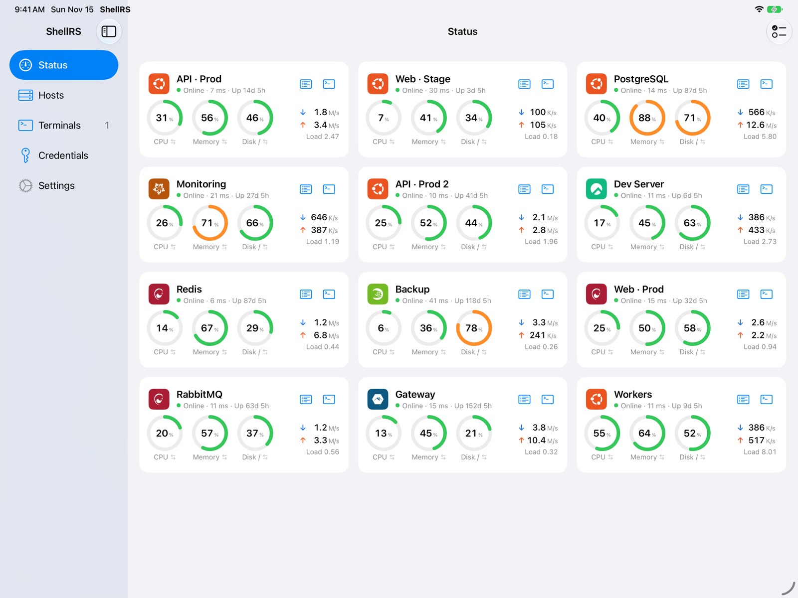
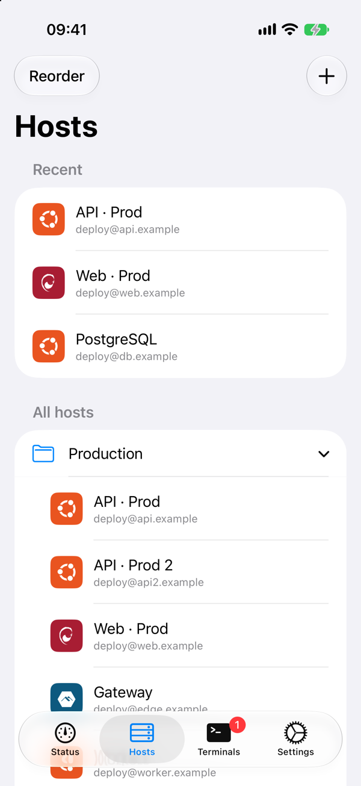
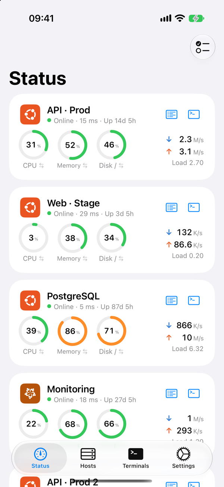
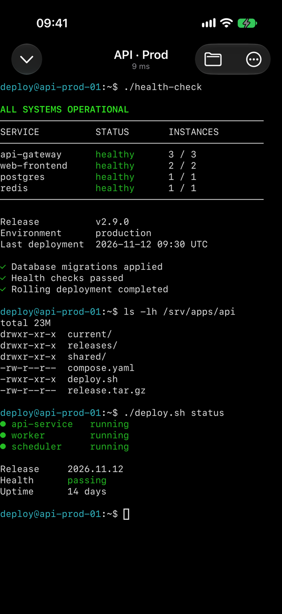
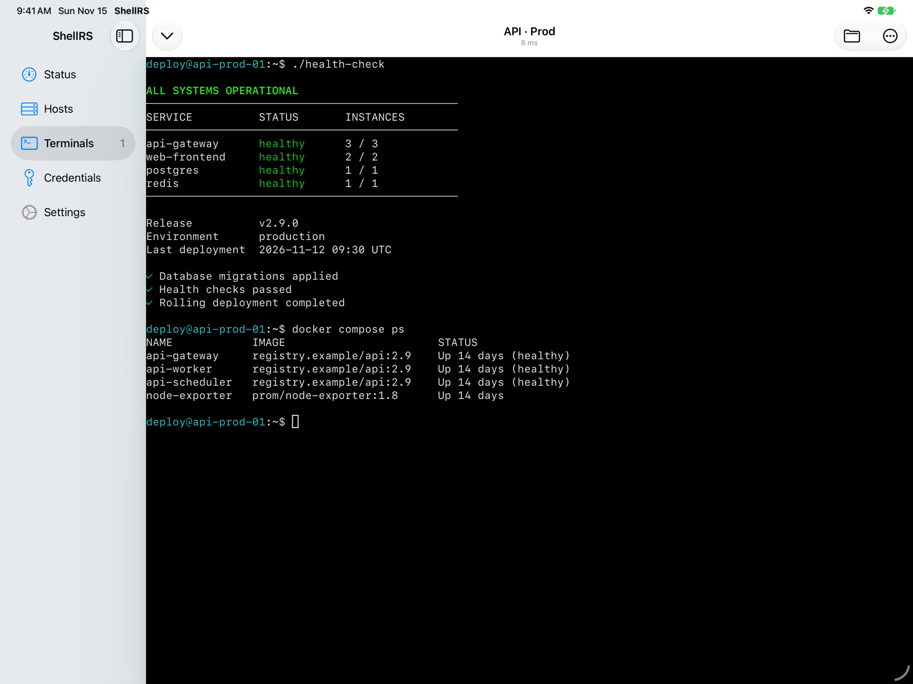
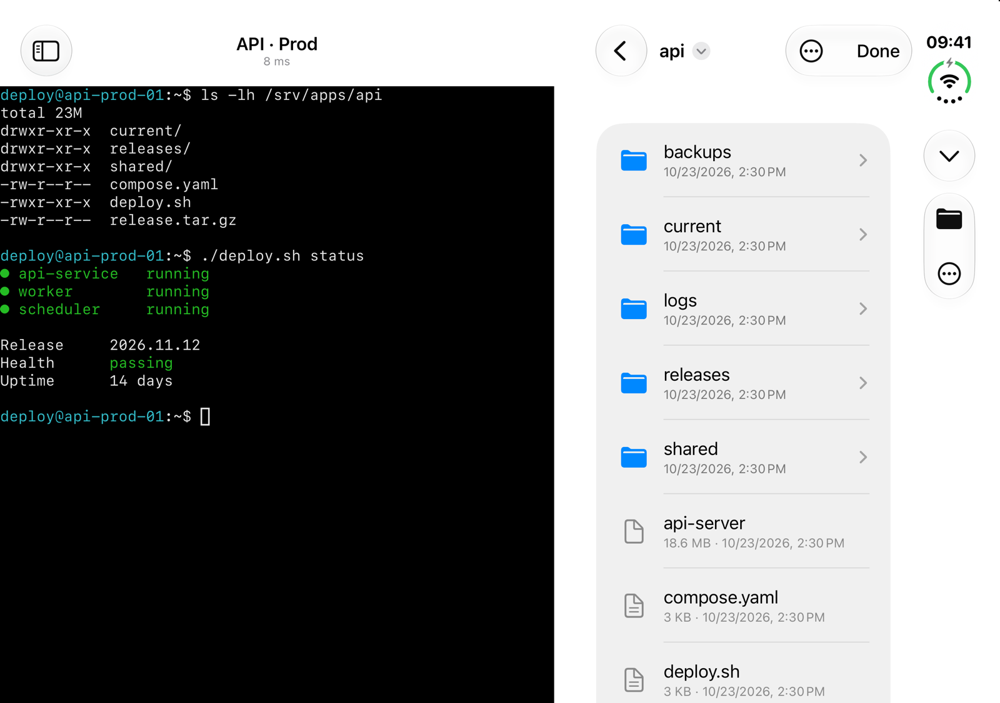

<p align="center">
  
</p>

<h1 align="center">ShellRS for iOS</h1>

<p align="center">
  A free, open-source SSH client for iPhone and iPad: host management, a terminal, SFTP files, live server status, and end-to-end encrypted sync with ShellRS on your computer.
</p>

<p align="center">
  <a href="#license"></a>
  
  
  
  <a href="https://github.com/sponsors/since2006"></a>
  <a href="https://linux.do"></a>
</p>

<p align="center"><b>English</b> | <a href="README.zh-CN.md">简体中文</a></p>

<p align="center">
  
</p>

## About

ShellRS for iOS is the iPhone and iPad edition of [ShellRS](https://github.com/since2006/shell-rs), the cross-platform SSH client. Connections, the host library and sync run in the same Rust core as the desktop app (`crates/shellrs-mobile` in shell-rs, with a Swift interface generated by UniFFI), so the two share their logic and their data format. The terminal is [SwiftTerm](https://github.com/migueldeicaza/SwiftTerm).

Hosts, groups and credentials live in a local SQLite database. Passwords, key passphrases and private keys go only into the iOS keychain; the database never holds a secret. With sync turned on, they reach your other devices end-to-end encrypted, through storage you choose.

Every feature is free. The app shows a few ads, and a one-time in-app purchase removes them.

## Features

**Hosts**

- Groups nest to any depth. Search them, reorder them, and find your recent connections at the top.
- The remote system is detected on connect and shown as its logo and color (Linux distributions, the BSDs, macOS, Windows).
- Log in with a password, a saved credential (a password or a private key), or no password at all.
- Connect directly, through SSH jump hosts, or through an HTTP or SOCKS5 proxy. The terminal, SFTP and Status all follow it.
- "Test connection" logs in once with what's in the form, without saving the host, and explains any failure.
- Telnet hosts can be kept and synced here too; connecting to them is desktop-only for now.

**Status**

- Turn on "Show on Status" for a host to watch its CPU, memory, disk, network and load, live. On iPhone each server is a card; on iPad the cards form a grid.
- Tap a ring to flip it: CPU to the 1, 5 and 15 minute load, memory to swap, disk to I/O busy time.
- Tap a card for the details: every core, load averages, memory and swap, each network interface and TCP connections, each mount and disk's I/O, failed systemd services and system information.
- Processes in a table, sorted by CPU or memory.
- Nothing to install on the server: one read-only shell command over SSH reads `/proc`, `df` and `systemctl`. Linux hosts only. Status connects only while you look at it, and disconnects when the app goes to the background.

**Terminal**

- Full terminal emulation with SwiftTerm: vim, htop and other full-screen programs work.
- Keep several terminals open and switch between them on the Terminals page. Each shows its live round-trip latency.
- When a connection drops, a bar says why: reconnect or close with a tap, or with Enter and Space on a keyboard.
- Font size from 10 to 28. Hardware keyboards and Chinese input work.

**Files (SFTP)**

- Opens on the terminal's own connection, so there's no second login, which helps behind a bastion host.
- Browse, create folders, rename and delete. A file's info shows its size, modified time, permissions and owner.
- Upload from the Files app or by drag and drop. Downloads go to Files › On My iPhone › ShellRS, sorted by host and full server path.
- Preview with Quick Look.
- Transfers queue up one batch at a time; stop, resume or cancel them. A batch cut off by a dropped connection carries on after the terminal reconnects.

**Sync**

- End-to-end encrypted sync with ShellRS on macOS, Windows and Linux and on your other iPhones and iPads, through your own WebDAV server (Nextcloud, a Synology NAS…) or S3 bucket (AWS S3, Cloudflare R2, MinIO, Alibaba Cloud OSS, Tencent Cloud COS…).
- Everything is encrypted before it leaves the device; the server holds only ciphertext, and only devices with the sync password can read it.
- Join with a setup code: scan the QR code another device shows (or paste the code) and enter the sync password.

**iPad and iPhone Duo**

- In a wide window, a sidebar menu (Status, Hosts, Terminals, Credentials, Settings) with the selected page beside it. Narrower windows, such as iPhone or a narrow Split View, use tabs.
- The terminal and its files side by side.
- On iPhone Duo, the inner screen gets the wide layout, and the terminal keeps clear of the fold and the cameras.
- Folding, unfolding and resizing keep your sessions, the current page and any form you haven't finished.
- [Keyboard shortcuts](#keyboard-shortcuts) for hosts, search, settings and terminals.

**Security and privacy**

- Secrets stay in the iOS keychain, for this device only: a backup doesn't carry them to another device. They travel between devices only through ShellRS's own encrypted sync.
- No tracking: no App Tracking Transparency prompt, and the advertising identifier is never read. Where the law requires it (the EEA, the UK, Switzerland), Google's consent form comes first.
- ShellRS sends no usage statistics. Once ads are removed, the ad SDK isn't even started.

**Free, with ads**

- Every feature is free. Ads support development: a banner on the iPhone's Hosts page, and a native ad on the Terminals page and, in a wide window, on the start, Hosts and Status pages. There are none in terminals, files, forms or settings.
- "Remove Ads", a one-time in-app purchase in Settings, removes them for good.
- Builds from this repository only ever show Google's test ads. To build without ads, see [Ads and Remove Ads](docs/ADS.md) (in Chinese).

## Screenshots

<p align="center">
  &nbsp;
  &nbsp;
  <br>
  <em>iPhone: hosts in groups, live server status, and the terminal</em>
</p>

<p align="center">
  <br>
  <em>iPad: a big terminal beside the sidebar menu</em>
</p>

<p align="center">
  <br>
  <em>iPhone Duo: the terminal on one side of the fold, its files on the other</em>
</p>

## Download

ShellRS for iOS is coming to the App Store. It runs on iPhone, iPad and iPhone Duo with iOS 17 or later. Until then, you can [build it from source](#building-from-source).

ShellRS for macOS, Windows and Linux is at [shellrs.com/download](https://shellrs.com/download).

## Getting started

1. On the Hosts page, tap + and fill in the address, port, user and how to log in. Passwords go into the keychain.
2. Tap a host to open a terminal. On the first connection you're asked to confirm the host key.
3. In a terminal, tap the folder button to browse the host's files over SFTP.
4. To watch a server on the Status page, edit the host and turn on "Show on Status".
5. Already using ShellRS on a computer? There, click "Show setup code…" in Settings › Cloud sync. Here, go to Settings › Cloud sync › "Join an existing sync", scan the code and enter the sync password.

## Keyboard shortcuts

With a hardware keyboard, hold ⌘ to see them. They work in the terminal too, and match the desktop app.

| Shortcut | Action |
| --- | --- |
| ⌘N / ⌘⇧N | New host / new group |
| ⌘K | Search |
| ⌘, | Settings |
| ⌘B | Show or hide the sidebar (wide windows) |
| ⌘⌥B | Show or hide the files beside the terminal (wide windows) |
| ⌘W | Close the terminal shown |
| ⌘} / ⌘{ | Next / previous terminal |
| ⌘1 … ⌘8 | Show terminal 1 … 8; ⌘9 shows the last one |
| ⌘= / ⌘- / ⌘0 | Bigger / smaller / default font size |

## Building from source

You need Xcode 27.1 or later and [rustup](https://rustup.rs). The app runs on iOS 17 and later; the simulator build is for Apple silicon Macs.

```sh
git clone https://github.com/since2006/shell-rs.git
git clone https://github.com/since2006/shellrs-ios.git
cd shellrs-ios
rustup target add aarch64-apple-ios aarch64-apple-ios-sim
scripts/build-core.sh
open ShellRS.xcodeproj
```

`scripts/build-core.sh` builds the Rust core from `../shell-rs` (or `SHELLRS_DIR`) into `Packages/ShellRSCore`, and warns when that checkout isn't the commit in `Packages/ShellRSCore/core-revision`. On the first build, Xcode asks to trust SwiftTerm's build plugin: choose "Trust & Enable". To run on a device, put `DEVELOPMENT_TEAM = <your Team ID>` in a new `Config/Local.xcconfig`, which stays out of Git.

Run the tests from the command line with a simulator you have installed (`xcrun simctl list devices available`):

```sh
xcodebuild -project ShellRS.xcodeproj -scheme ShellRS \
  -destination 'platform=iOS Simulator,name=iPhone 17' \
  -skipPackagePluginValidation test
```

See the [development notes](docs/DEVELOPMENT.md) (in Chinese) for the tests against a real SSH server, the layout rules and the code conventions.

## Documentation

The documentation is in Chinese for now:

- [Development](docs/DEVELOPMENT.md): building, testing, the layouts, where the code is and its conventions
- [Ads and Remove Ads](docs/ADS.md): where the ads go, when they load, consent, the purchase, and building without ads
- [Building and releasing](docs/RELEASE.md): CI, signing and uploading to App Store Connect
- The desktop app's [user manual](https://github.com/since2006/shell-rs/blob/main/docs/manual.md) (in English) explains sync and setup codes in detail

## Not on iOS yet

Compared with the desktop app, the iOS edition doesn't have these yet:

- Port forwarding
- Telnet connections
- The desktop's other sidebar tools: Docker, services, network connections, tmux, Kubernetes, command history and snippets
- ZMODEM (`rz` / `sz`) in the terminal

## Contributing

Issues and pull requests are welcome on [GitHub](https://github.com/since2006/shellrs-ios/issues). The code conventions are in the [development notes](docs/DEVELOPMENT.md) (in Chinese). Before sending a change, make sure the tests above pass. Changes the core needs go to `crates/shellrs-mobile` in [shell-rs](https://github.com/since2006/shell-rs) first.

## Support ShellRS

If ShellRS is useful to you, consider [sponsoring its development on GitHub](https://github.com/sponsors/since2006), or buying "Remove Ads" in the app. Your support helps sustain ongoing maintenance, bug fixes and new features. Thank you for supporting ShellRS!

## Acknowledgements

- [SwiftTerm](https://github.com/migueldeicaza/SwiftTerm): terminal emulation
- [russh](https://github.com/Eugeny/russh) and [russh-sftp](https://github.com/AspectUnk/russh-sftp), through the shell-rs core: SSH and SFTP
- [UniFFI](https://github.com/mozilla/uniffi-rs): the Swift interface to the Rust core
- [Simple Icons](https://simpleicons.org): the system logos on hosts (CC0)

## License

ShellRS for iOS is licensed under the [MIT License](LICENSE), as are the shell-rs core crates the app links (`shellrs-mobile`, `shellrs-ssh`, `shellrs-hosts`, `shellrs-sync`). The third-party open-source components in the app are listed in [`ShellRS/About/Licenses.json`](ShellRS/About/Licenses.json). The Google Mobile Ads and User Messaging Platform SDKs are used under Google's terms and are not covered by the MIT License.
