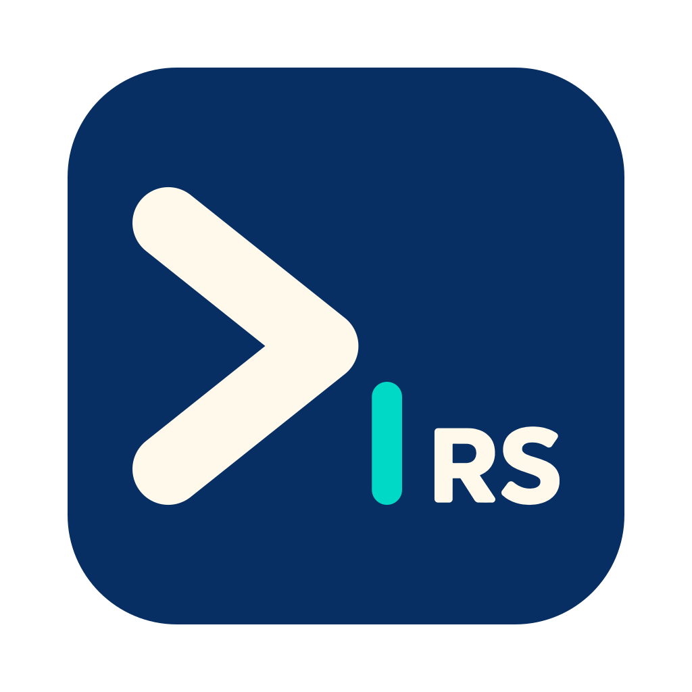
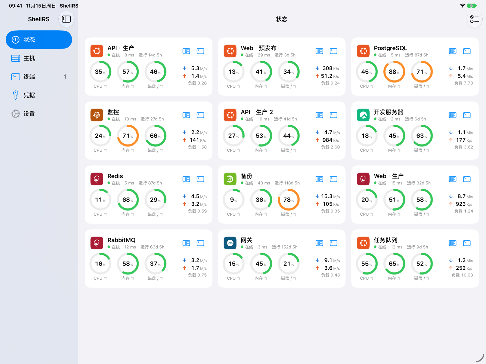
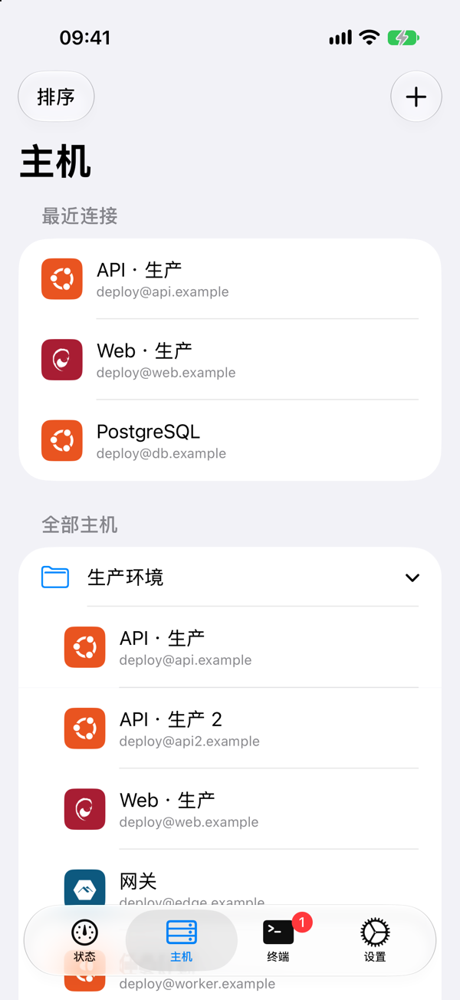
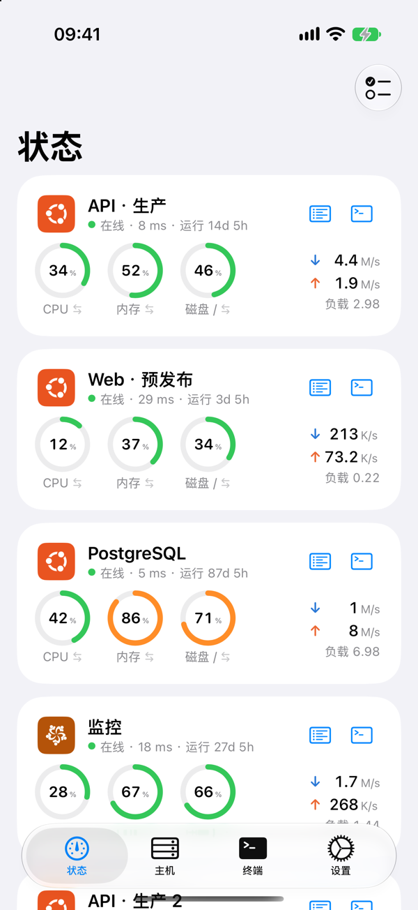
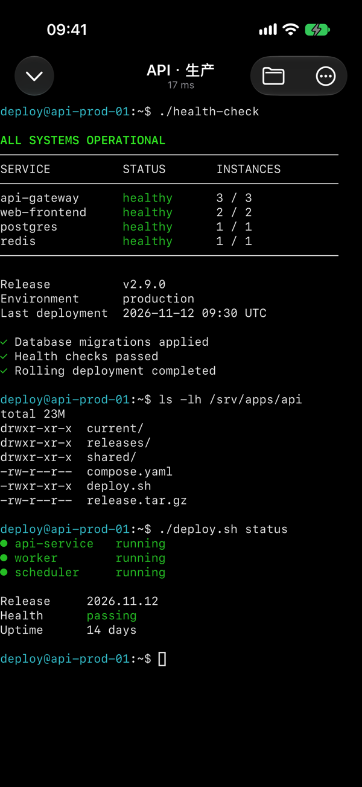
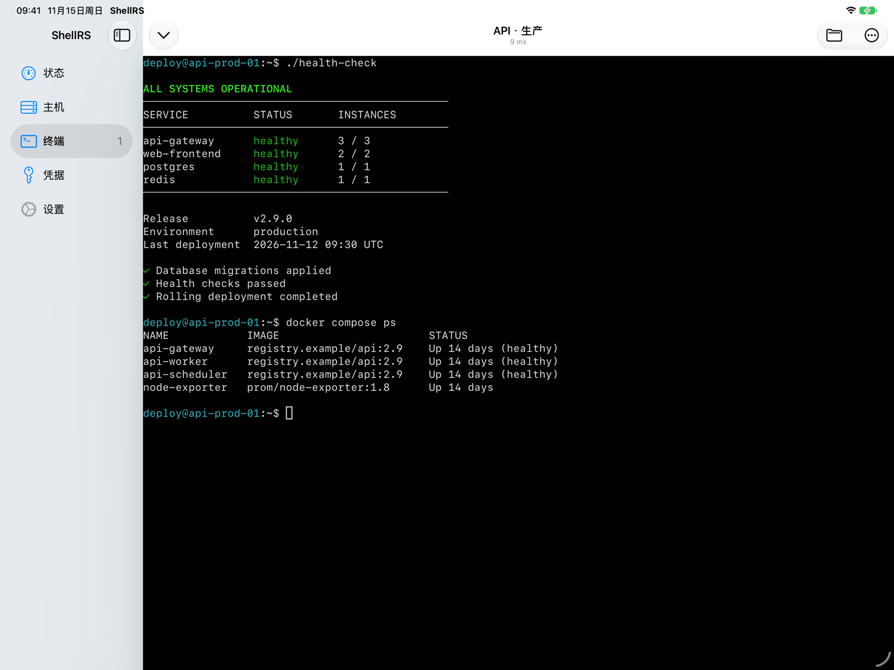
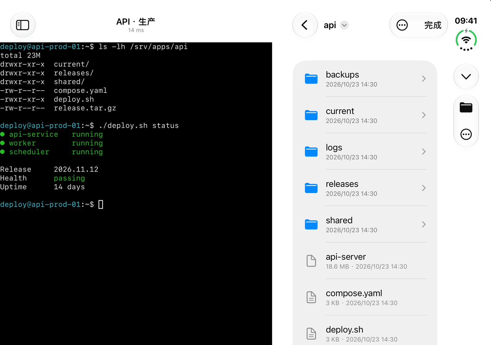

<p align="center">
  
</p>

<h1 align="center">ShellRS for iOS</h1>

<p align="center">
  免费、开源的 iPhone / iPad SSH 客户端：主机管理、终端、SFTP 文件、服务器实时状态，以及和电脑上的 ShellRS 端到端加密同步。
</p>

<p align="center">
  <a href="#许可证"></a>
  
  
  
  <a href="https://github.com/sponsors/since2006"></a>
  <a href="https://linux.do"></a>
</p>

<p align="center"><a href="README.md">English</a> | <b>简体中文</b></p>

<p align="center">
  
</p>

## 简介

ShellRS for iOS 是跨平台 SSH 客户端 [ShellRS](https://github.com/since2006/shell-rs) 的 iPhone / iPad 版。连接、主机库和同步都在和电脑版相同的 Rust 核心里（shell-rs 的 `crates/shellrs-mobile`，经 UniFFI 生成 Swift 接口），两边共用同一套逻辑和数据格式；终端模拟用 [SwiftTerm](https://github.com/migueldeicaza/SwiftTerm)。

主机、分组和凭据保存在本地的 SQLite 数据库里。密码、私钥口令和私钥只存进 iOS 钥匙串，数据库里没有任何秘密。开启同步后，它们经你自己选的存储端到端加密地同步到其他设备。

全部功能免费。App 里有少量广告，一次性内购就能去掉。

## 功能

**主机管理**

- 分组可以任意层级嵌套，支持搜索和排序，最近连接列在最上面。
- 连上主机后自动识别远程系统，显示对应的图标和品牌色（各 Linux 发行版、BSD、macOS、Windows）。
- 认证方式三选一：密码、使用凭据（密码或私钥）、无密码。
- 连接方式三选一：直接连接、SSH 跳板、HTTP / SOCKS5 代理。终端、SFTP 和「状态」都按它连接。
- 「测试连接」用表单里现在的设置登录一次，不保存主机，失败时写明原因。
- Telnet 主机也可以在这里保存和同步，暂时只能在电脑上连接。

**服务器状态**

- 在主机里打开「在状态页面中显示」，就能实时查看它的 CPU、内存、磁盘、网络和负载。iPhone 上每台服务器一张卡片，iPad 上卡片排成网格。
- 点圆环可以翻面：CPU 翻到 1、5、15 分钟负载，内存翻到交换空间，磁盘翻到 I/O 繁忙程度。
- 点卡片看详情：每个核、负载、内存和交换空间、每块网卡和 TCP 连接数、每个挂载点和每块盘的读写、失败的 systemd 服务、系统信息。
- 进程是一张表，可以按 CPU 或内存排序。
- 服务器上不用装任何东西：经 SSH 执行一条只读的 shell 命令，读 `/proc`、`df` 和 `systemctl`。只支持 Linux 主机。只在看「状态」页时连接，App 进后台就断开。

**终端**

- 基于 SwiftTerm 的完整终端模拟，vim、htop 等全屏程序正常显示。
- 可以同时打开多个终端，在「终端」页切换；每个终端实时显示连接的往返延迟。
- 连接断开时显示断开条并写明原因，点一下重连或关闭；接了键盘时按 Enter 重连、按 Space 关闭。
- 字号 10–28。支持外接键盘和中文输入法。

**文件（SFTP）**

- 开在终端自己的连接上，不用再登录一次，在堡垒机后面尤其省事。
- 浏览、新建文件夹、重命名、删除；文件简介里有大小、修改时间、权限和所有者。
- 从「文件」App 选取或直接拖进来上传。下载放在「文件」App 的「我的 iPhone › ShellRS」里，按主机和服务器上的完整路径存放。
- 用快速查看预览。
- 传输一次一批，排队进行，可以停止、继续或取消。连接断开时传到一半的批次，终端重连后接着传。

**云同步**

- 和 macOS、Windows、Linux 上的 ShellRS 以及你的其他 iPhone、iPad 端到端加密同步，走你自己的 WebDAV（Nextcloud、群晖等）或 S3 存储桶（AWS S3、Cloudflare R2、MinIO、阿里云 OSS、腾讯云 COS 等）。
- 数据离开设备前就已加密，服务器上只有密文，只有拥有同步密码的设备能解开。
- 用配置码加入：扫描另一台设备显示的二维码（或粘贴配置码），再输入同步密码。

**iPad 与 iPhone Duo**

- 宽窗口里左边是侧栏菜单（状态、主机、终端、凭据、设置），右边显示选中的页面。较窄的窗口（iPhone、窄的分屏）用标签页。
- 终端和它的文件左右并排。
- iPhone Duo 的内屏用宽布局，终端避开折痕和摄像头。
- 折叠、展开和调整窗口大小时，会话、当前页面和没填完的表单都会保留。
- 主机、搜索、设置和终端都有[键盘快捷键](#键盘快捷键)。

**安全与隐私**

- 秘密只存在 iOS 钥匙串里，并且只属于这台设备：备份不会把它们带到另一台设备上，设备之间只经 ShellRS 自己的加密同步传递。
- 不跟踪：不弹 App 跟踪透明度请求，不读广告标识符。法律要求的地区（欧洲经济区、英国、瑞士）先弹 Google 的同意书。
- ShellRS 不发送使用统计。去除广告后，连广告 SDK 都不会启动。

**免费与广告**

- 全部功能免费，开发靠广告支持：iPhone 的「主机」页有一条横幅，「终端」页以及宽窗口的开始页、「主机」页和「状态」页各有一条原生广告。终端、文件、表单和设置里都没有广告。
- 设置里的「去除广告」是一次性内购，买了永久去掉广告。
- 从本仓库编出的构建只显示 Google 的测试广告。不要广告的构建见[广告与去除广告](docs/ADS.md)。

## 截图

<p align="center">
  &nbsp;
  &nbsp;
  <br>
  <em>iPhone：分组的主机、服务器实时状态和终端</em>
</p>

<p align="center">
  <br>
  <em>iPad：侧栏菜单旁的大屏终端</em>
</p>

<p align="center">
  <br>
  <em>iPhone Duo：折痕一侧是终端，另一侧是它的文件</em>
</p>

## 下载

ShellRS for iOS 即将上架 App Store，支持 iOS 17 及以上的 iPhone、iPad 和 iPhone Duo。在那之前，可以[从源码构建](#从源码构建)。

macOS、Windows、Linux 版到 [shellrs.com/download](https://shellrs.com/download) 下载。

## 快速上手

1. 在「主机」页点 +，填写地址、端口、用户名和认证方式，密码会存进钥匙串。
2. 点主机打开终端。第一次连接时会请你确认主机密钥。
3. 在终端里点文件夹按钮，经 SFTP 浏览这台主机的文件。
4. 想在「状态」页查看服务器，编辑主机，打开「在状态页面中显示」。
5. 电脑上已经在用 ShellRS？在电脑的「设置 › 云同步」里点「显示配置码…」，再在手机的「设置 › 云同步 › 加入已有的同步」里扫码，输入同步密码。

## 键盘快捷键

接上硬件键盘后，按住 ⌘ 就能看到。终端里也能用，按键和电脑版一样。

| 快捷键 | 动作 |
| --- | --- |
| ⌘N / ⌘⇧N | 新建主机 / 新建分组 |
| ⌘K | 搜索 |
| ⌘, | 打开设置 |
| ⌘B | 显示或隐藏侧栏（宽窗口） |
| ⌘⌥B | 显示或隐藏终端旁的文件（宽窗口） |
| ⌘W | 关闭显示着的终端 |
| ⌘} / ⌘{ | 下一个 / 上一个终端 |
| ⌘1 … ⌘8 | 显示第 1 … 8 个终端；⌘9 是最后一个 |
| ⌘= / ⌘- / ⌘0 | 放大 / 缩小 / 默认字号 |

## 从源码构建

需要 Xcode 27.1 或更新版本，以及 [rustup](https://rustup.rs)。App 最低支持 iOS 17；模拟器构建只支持 Apple 芯片的 Mac。

```sh
git clone https://github.com/since2006/shell-rs.git
git clone https://github.com/since2006/shellrs-ios.git
cd shellrs-ios
rustup target add aarch64-apple-ios aarch64-apple-ios-sim
scripts/build-core.sh
open ShellRS.xcodeproj
```

`scripts/build-core.sh` 用 `../shell-rs`（或 `SHELLRS_DIR` 指向的目录）编出 Rust 核心，放进 `Packages/ShellRSCore`；检出的提交和 `Packages/ShellRSCore/core-revision` 不一致时会提醒。第一次构建时 Xcode 会问是否信任 SwiftTerm 的构建插件，选「Trust & Enable」。要在真机上运行，新建 `Config/Local.xcconfig`（不进 Git），写一行 `DEVELOPMENT_TEAM = 你的 Team ID`。

命令行跑测试，模拟器换成本机装了的（`xcrun simctl list devices available`）：

```sh
xcodebuild -project ShellRS.xcodeproj -scheme ShellRS \
  -destination 'platform=iOS Simulator,name=iPhone 17' \
  -skipPackagePluginValidation test
```

连真实 SSH 服务器的测试、布局规则和代码约定见[开发说明](docs/DEVELOPMENT.md)。

## 文档

- [开发说明](docs/DEVELOPMENT.md)：构建、测试、布局、代码目录和约定
- [广告与去除广告](docs/ADS.md)：广告位置、加载时机、同意书、内购，以及不要广告的构建
- [构建与发布](docs/RELEASE.md)：CI、签名和上传到 App Store Connect
- 电脑版的[使用手册](https://github.com/since2006/shell-rs/blob/main/docs/manual.zh.md)详细说明了云同步和配置码

## iOS 版暂时没有的功能

和电脑版相比，iOS 版暂时还没有：

- 端口转发
- Telnet 连接
- 电脑版右侧栏的其他工具：Docker、系统服务、网络连接、tmux、Kubernetes、历史命令和命令片段
- 终端里的 ZMODEM（`rz` / `sz`）

## 参与贡献

欢迎在 [GitHub](https://github.com/since2006/shellrs-ios/issues) 提交 Issue 和 Pull Request。代码约定见[开发说明](docs/DEVELOPMENT.md)。提交前请确认上面的测试全部通过。核心需要的改动先提交到 [shell-rs](https://github.com/since2006/shell-rs) 的 `crates/shellrs-mobile`。

## 支持 ShellRS

如果 ShellRS 对你有帮助，欢迎通过 [GitHub Sponsors 赞助开发](https://github.com/sponsors/since2006)，或在 App 里购买「去除广告」。你的支持将帮助项目持续维护、修复问题和开发新功能。感谢你支持 ShellRS！

## 致谢

- [SwiftTerm](https://github.com/migueldeicaza/SwiftTerm)：终端模拟
- [russh](https://github.com/Eugeny/russh) 和 [russh-sftp](https://github.com/AspectUnk/russh-sftp)（经 shell-rs 核心）：SSH 与 SFTP 协议
- [UniFFI](https://github.com/mozilla/uniffi-rs)：Rust 核心的 Swift 接口
- [Simple Icons](https://simpleicons.org)：主机上的系统图标（CC0）

## 许可证

ShellRS for iOS 以 [MIT 许可证](LICENSE)发布，App 链接的 shell-rs 核心 crate（`shellrs-mobile`、`shellrs-ssh`、`shellrs-hosts`、`shellrs-sync`）同样是 MIT。App 用到的第三方开源组件列在 [`ShellRS/About/Licenses.json`](ShellRS/About/Licenses.json)。Google Mobile Ads 和 User Messaging Platform SDK 按 Google 的条款使用，不在 MIT 许可之内。
